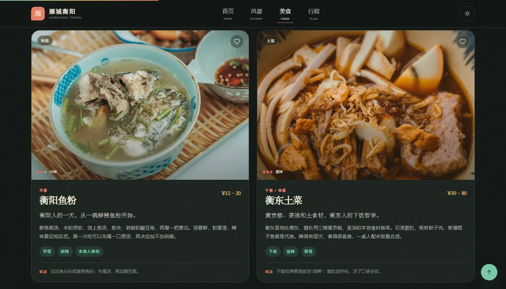
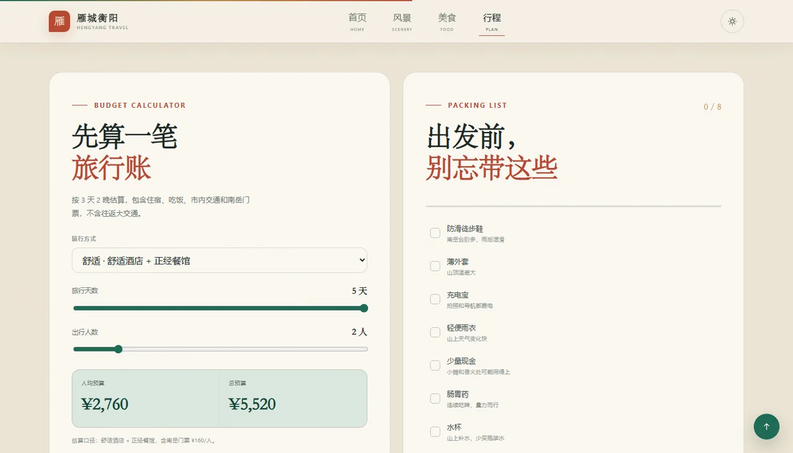

# 全栈开发实验报告

## 实验名称：基于 Vue 3 的衡阳旅行网站

| 项目 | 内容 |
| --- | --- |
| 姓名 | __________ |
| 学号 | __________ |
| 班级 | __________ |
| 实验日期 | 2026 年 10 月 |
| 项目目录 | `exp4/` |
| 在线地址 | <https://asuka060108.github.io/hengyang-vue-travel/> |
| 源码仓库 | <https://github.com/asuka060108/hengyang-vue-travel> |

> 说明：本文为自由格式实验报告。如所在班级要求使用指定模板，可将以下章节内容按模板顺序迁移。

---

## 一、实验目的

1. 使用 Vue 3 完成一个纯前端、多页面的主题网站。
2. 掌握 Vue 单文件组件（SFC）的拆分与组件通信。
3. 覆盖 Vue 官方教程中的模板语法、响应式、计算属性、侦听器、生命周期、组件、插槽、路由、过渡、Teleport、依赖注入等知识点。
4. 完成一个主题明确、视觉完整、可在桌面端和移动端使用的衡阳旅行指南。
5. 将网站部署到公网，验证构建产物与 SPA 路由回退。

## 二、实验环境

- 操作系统：Windows
- 开发工具：VS Code / PowerShell
- 运行时：Node.js 24
- 包管理器：pnpm 11
- 核心依赖：Vue 3.5.44、Vue Router 4.6.4、Vite 7.3.7
- 浏览器验证：Microsoft Edge（无头模式）
- 部署：GitHub Pages

## 三、需求分析

网站主题为「衡阳旅行」，需要同时介绍衡阳的风景与美食，并具备一定的交互性，而不是静态宣传页。

功能需求：

1. **首页**：整体气质、衡阳简介、精选风景、精选美食、三日行程入口、旅行提示。
2. **风景页**：6 处衡阳目的地，支持分类筛选、关键词搜索、排序和景点详情查看。
3. **美食页**：8 种衡阳味道，支持分类筛选、搜索、辣度排序、收藏与收藏清单。
4. **行程页**：三日时间轴、预算估算、行前清单、交通建议和旅行提示。
5. **通用能力**：响应式布局、日/夜主题、页面切换动画、滚动入场、返回顶部、404 页面。

非功能需求：

- 不依赖后端，纯前端运行；
- 至少 3 个页面、15 个 SFC；
- 技术内容覆盖 Vue 教程知识点；
- 可构建、可部署、可通过公网访问；
- 在移动端不出现横向溢出。

## 四、总体设计

### 4.1 页面与路由

| 路由 | 页面 | 主要功能 |
| --- | --- | --- |
| `/` | 首页 | Hero、数据条、风景/美食精选、行程预览、旅行提示 |
| `/scenery` | 风景 | 分类、搜索、排序、景点卡片、详情弹窗 |
| `/food` | 美食 | 分类、搜索、辣度排序、收藏、味觉清单 |
| `/plan` | 行程 | 三日时间轴、预算计算器、行前清单、交通 |
| `/:pathMatch(.*)*` | 404 | 路由兜底 |

### 4.2 组件拆分

共 **24 个 Vue 单文件组件**：

**根组件与页面（6）**

1. `App.vue`
2. `HomeView.vue`
3. `SceneryView.vue`
4. `FoodView.vue`
5. `PlanView.vue`
6. `NotFoundView.vue`

**通用组件（18）**

7. `AppHeader.vue`
8. `AppFooter.vue`
9. `FooterNav.vue`
10. `ThemeToggle.vue`
11. `ScrollProgress.vue`
12. `BackToTop.vue`
13. `HeroSection.vue`
14. `PageHero.vue`
15. `SectionHeading.vue`
16. `StatStrip.vue`
17. `SpotCard.vue`
18. `FoodCard.vue`
19. `FilterTabs.vue`
20. `SpotModal.vue`
21. `FavoritesBar.vue`
22. `EmptyState.vue`
23. `TravelTips.vue`
24. `ItineraryTimeline.vue`

### 4.3 目录结构

```text
exp4/
├── index.html
├── package.json
├── vite.config.js
├── pnpm-workspace.yaml
├── public/
│   ├── favicon.svg
│   └── _redirects
├── scripts/
│   └── postbuild.mjs
├── src/
│   ├── main.js
│   ├── App.vue
│   ├── router/index.js
│   ├── data/
│   │   ├── attractions.js
│   │   ├── foods.js
│   │   └── itinerary.js
│   ├── composables/
│   │   ├── useTheme.js
│   │   └── useFavorites.js
│   ├── directives/
│   │   └── reveal.js
│   ├── assets/
│   │   ├── images/
│   │   └── styles/main.css
│   ├── components/  （18 个）
│   └── views/       （5 个页面组件）
├── docs/            （报告截图）
├── preview.webp
├── README.md
└── 实验报告.md
```

## 五、Vue 知识点实现

| 教程知识点 | 实现位置 | 说明 |
| --- | --- | --- |
| 创建应用 | `src/main.js` | `createApp(App).use(router).mount('#app')` |
| 模板语法 / 插值 | 所有 SFC | 文案、统计数字、章节数据 |
| 属性绑定 | `SpotCard.vue`、`PageHero.vue` | 图片、样式、`object-position` |
| 响应式 `ref` | 搜索、筛选、主题、弹窗状态 | `ref` 管理基本类型和对象 |
| 响应式 `reactive` | `PlanView.vue` | 行前清单数组、预算状态 |
| 计算属性 | `SceneryView.vue`、`FoodView.vue`、`PlanView.vue` | 过滤结果、收藏清单、预算、进度 |
| `watch` | `SceneryView.vue`、`PlanView.vue` | 筛选条件同步 URL；清单持久化 |
| `watchEffect` | `useTheme.js` | 主题变化同步到 `data-theme` 与 meta |
| 生命周期 | `AppHeader.vue`、`ScrollProgress.vue`、`BackToTop.vue`、`SpotModal.vue` | 滚动、keydown、焦点、body 锁滚动 |
| Class / Style 绑定 | 导航、筛选、主题、进度条 | 激活状态、宽度、CSS 变量 |
| `v-if` / `v-else` | 弹窗、收藏栏、空状态、移动菜单 | 条件渲染 |
| `v-for` | 景点、美食、时间轴、清单、标签 | 列表渲染 |
| 事件处理 | 搜索、收藏、筛选、弹窗、主题 | `@click`、`@input`、`@keydown` |
| 表单绑定 | 搜索框、排序、range、checkbox | `v-model`、`v-model.number` |
| 组件 `v-model` | `FilterTabs.vue` | `defineModel` 实现分类双向绑定 |
| Props | `SpotCard.vue`、`FoodCard.vue`、`PageHero.vue` | 数据向下传递 |
| Emits | `SpotCard`、`FoodCard`、`SpotModal`、`FavoritesBar` | 打开弹窗、切换收藏、关闭 |
| 插槽 | `SectionHeading`、`PageHero`、`EmptyState` | 默认插槽 / 具名插槽 |
| 模板引用 | `SceneryView`、`FoodView`、`SpotModal` | 搜索框聚焦、关闭按钮聚焦 |
| 依赖注入 | `App.vue` → `ThemeToggle.vue` | `provide('theme')` / `inject('theme')` |
| 自定义指令 | `directives/reveal.js` | `v-reveal` + IntersectionObserver |
| Vue Router | `router/index.js` | 懒加载、404、query、滚动行为、标题 |
| 页面过渡 | `App.vue` | `<Transition name="page">` |
| 列表过渡 | 风景/美食卡片、行程 | `<TransitionGroup>` |
| Teleport | `SpotModal.vue` | 弹窗挂到 `body` |
| KeepAlive | `App.vue` | 缓存最多 3 个页面组件 |
| 组合式函数 | `useTheme`、`useFavorites` | 复用状态与持久化逻辑 |
| 插槽 / 组件复用 | 全站 | 标题、卡片、弹窗、空状态等复用 |
| 构建与部署 | `vite.config.js`、`postbuild.mjs` | base、构建、404 回退 |

## 六、关键功能实现

### 6.1 风景筛选与 URL 同步

`SceneryView.vue` 使用 `computed` 对景点做分类、关键词和排序过滤；使用 `watch` 把 `category`、`q`、`sort` 写回路由 query。刷新页面后可以从 URL 还原筛选条件。

```js
watch([activeCategory, search, sort], () => {
  const query = {};
  if (activeCategory.value !== 'all') query.category = activeCategory.value;
  if (search.value.trim()) query.q = search.value.trim();
  if (sort.value !== 'recommended') query.sort = sort.value;
  router.replace({ query });
});
```

### 6.2 景点详情弹窗

`SpotModal.vue` 使用 `Teleport` 将弹窗挂到 `body`，使用 `Transition` 实现进出动画。打开时锁定 `body` 滚动，聚焦关闭按钮；支持点击遮罩、点击关闭按钮和按 `Esc` 关闭。

### 6.3 收藏与 localStorage

`useFavorites.js` 是模块级单例组合式函数，维护 `favoriteIds`，用 `watch` 写入 localStorage。`FoodView` 中可筛选「我的清单」，`FavoritesBar` 展示已收藏菜品。

### 6.4 主题切换

`useTheme.js` 读取 localStorage 或系统偏好，`watchEffect` 把主题写入 `document.documentElement.dataset.theme`。`App.vue` 通过 `provide` 提供给 `ThemeToggle`，后者用 `inject` 获取。

### 6.5 预算与行前清单

`PlanView.vue` 使用 `computed` 计算人均预算和总预算，使用 `reactive` 管理 8 项行前清单，`watch(deep)` 持久化勾选状态。预算随旅行方式、天数、人数实时变化。

### 6.6 视觉与动画

- 首页沉浸式 Hero + 山景视差；
- 米纸色、墨绿、朱砂、金色的编辑式视觉；
- 滚动入场使用自定义指令；
- 路线时间轴、卡片筛选、主题切换、弹窗均有过渡；
- 响应式适配桌面、平板和手机；
- 支持 `prefers-reduced-motion`。

## 七、运行与测试

### 7.1 本地运行

```bash
pnpm install
pnpm dev
```

访问 `http://localhost:5173/`。

### 7.2 生产构建

```bash
pnpm build
pnpm preview
```

构建成功，`postbuild` 生成 `dist/404.html`，并为 `scenery`、`food`、`plan` 生成目录入口，用于 SPA 路由回退与直接访问。

### 7.3 浏览器验证

使用 Edge 无头浏览器对线上页面进行了实际检查：

- 首页、风景、美食、行程 4 个主页面均可访问；
- 6 个景点卡片、8 个美食卡片正常渲染；
- 分类筛选「古建」后结果为 2 项；
- 景点详情弹窗正常打开，且确实 Teleport 到 `body`；
- 收藏鱼粉后 localStorage 中写入 `["fish-noodles"]`；
- 行程页 3 个 DAY 标签、每段时间轴正常切换；
- 预算从人均 ¥1,720 / 总预算 ¥3,440 随参数变化；
- 主题切换写入 localStorage；
- 移动端 390 × 844 下菜单展开正常，无横向溢出；
- 控制台无运行时异常。

### 7.4 页面截图






## 八、部署

项目使用 GitHub Pages 部署：

- `main` 分支：源码；
- `gh-pages` 分支：`dist` 构建产物；
- SPA 路由通过 `404.html` 和路由目录入口回退；
- Vite `base` 设置为 `/hengyang-vue-travel/`。

构建命令：

```powershell
$env:VITE_BASE='/hengyang-vue-travel/'
pnpm build
```

公网地址：

<https://asuka060108.github.io/hengyang-vue-travel/>

## 九、实验总结

本项目完成了从需求分析、页面设计、组件拆分、状态管理、路由和部署的完整前端流程。通过 24 个 SFC，把页面拆成可复用的标题、卡片、弹窗、筛选、时间轴、预算和清单等模块；通过 `provide/inject`、`defineModel`、Teleport、TransitionGroup、自定义指令等特性，覆盖了 Vue 教程中的主要知识点。

在实现过程中也处理了几个实际问题：

1. SPA 部署到 GitHub Pages 时，刷新子路由会 404，通过构建后复制 `404.html` 解决；
2. 筛选条件写入 URL 时，路由滚动行为会干扰当前浏览位置，通过同路径 `return false` 保持滚动；
3. 卡片滚动入场动画的延迟不能污染筛选/离开动画，改用 CSS 动画延迟变量处理；
4. 图片资源需要压缩为 WebP，并统一使用 `object-fit` 控制不同比例的裁切。

最终网站已通过公网部署并完成浏览器端验证，满足 3 个以上页面、15 个以上 Vue 单文件组件和 Vue 教程知识点覆盖的要求。
